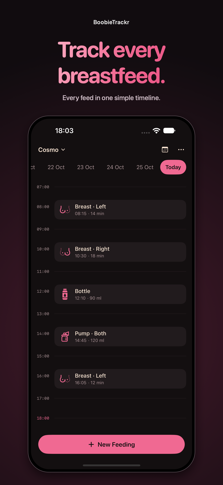
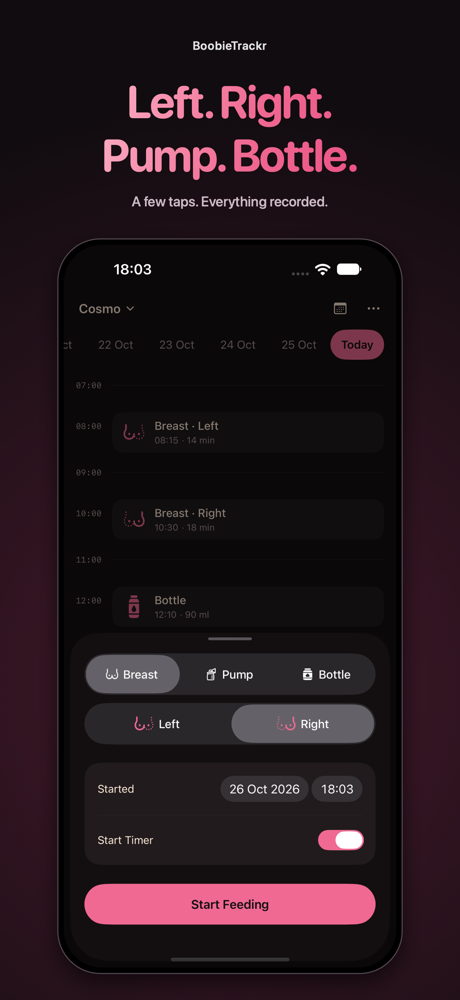
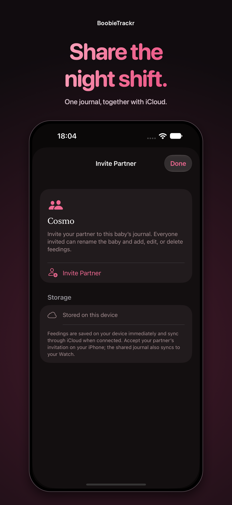
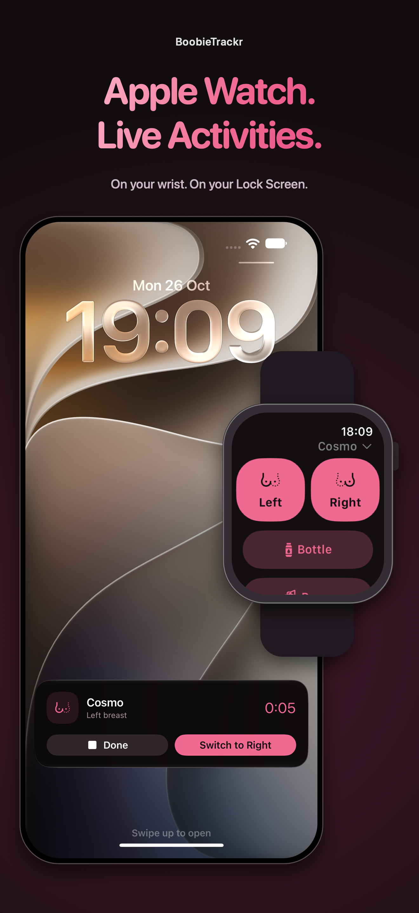

# BoobieTrackr

One less thing to remember.

A simple feeding journal for iPhone and Apple Watch, made for sleepy parents and middle-of-the-night feeds.

  
  
  
  

- **Every feed, together.** Track breastfeeding, bottles, and pumping in one timeline.
- **Left or right?** Get a suggested side based on the last feed, start a timer, and switch with a tap.
- **Share the night shift.** Invite your partner through iCloud so you can both add and edit feeds.
- **Made for your family.** Keep a separate journal for each baby.
- **Always within reach.** Log feeds from Apple Watch and follow timers on your iPhone’s Lock Screen.
- **Easy on sleepy eyes.** A dark interface, soft pink accents, and large controls.

Free. No ads. No separate account. Export your feeding history whenever you need it.

Made with love for my fiancée and our little one.
